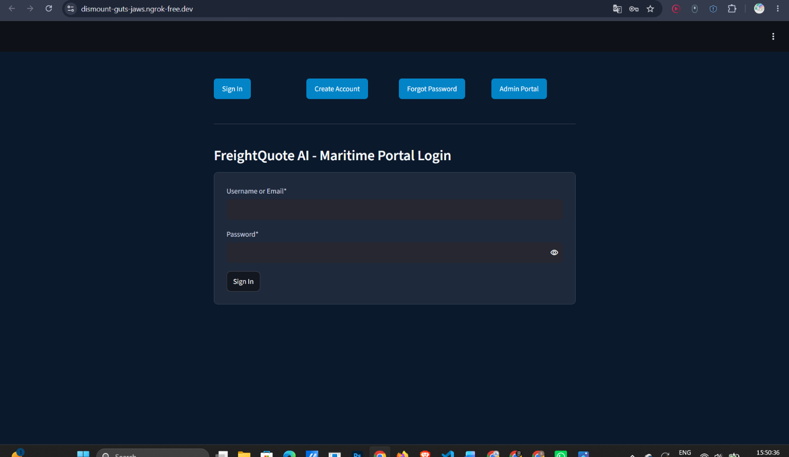
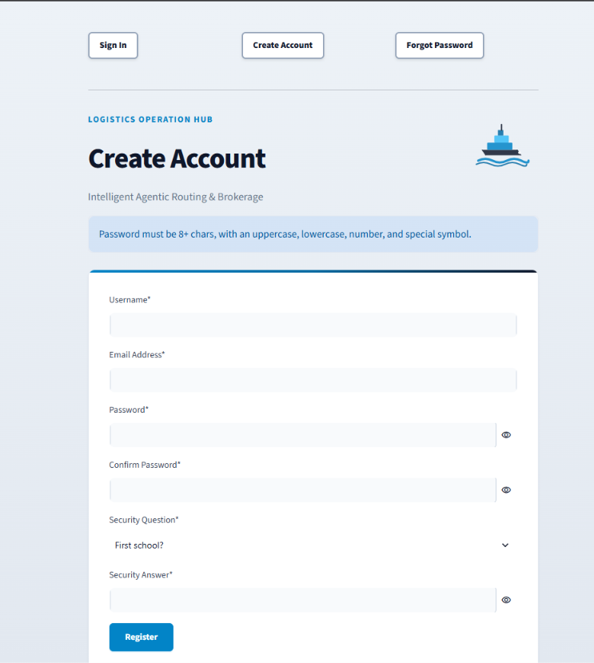
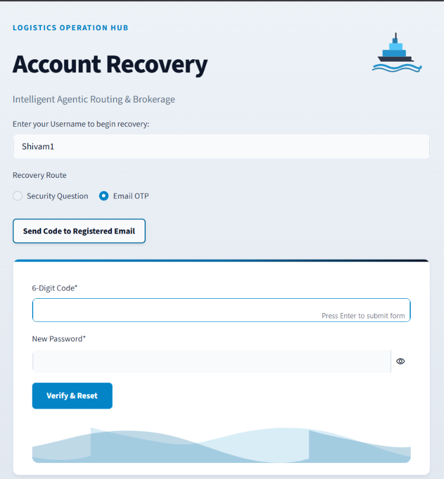
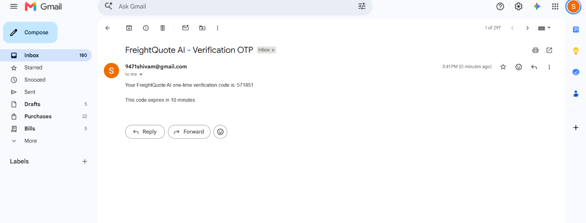
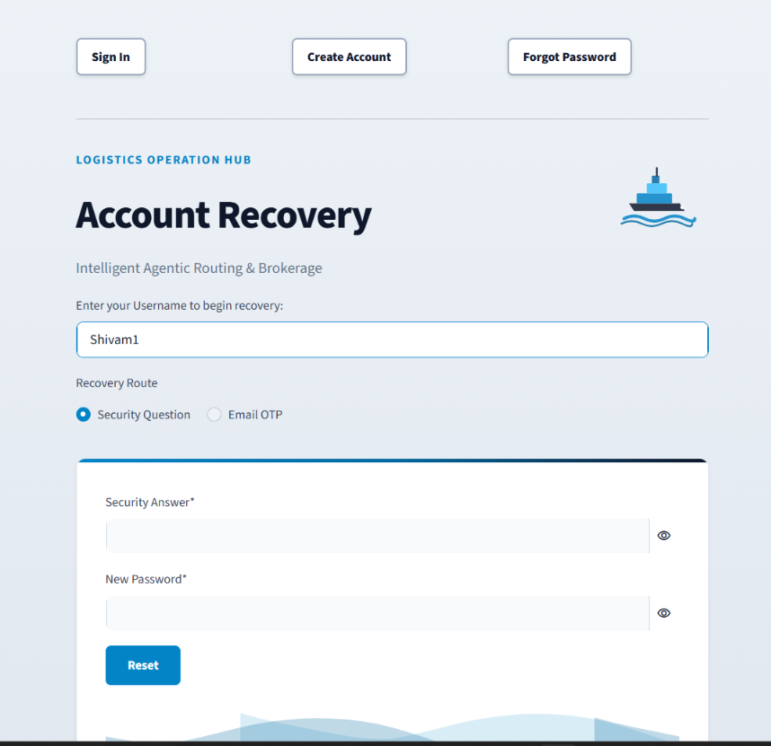
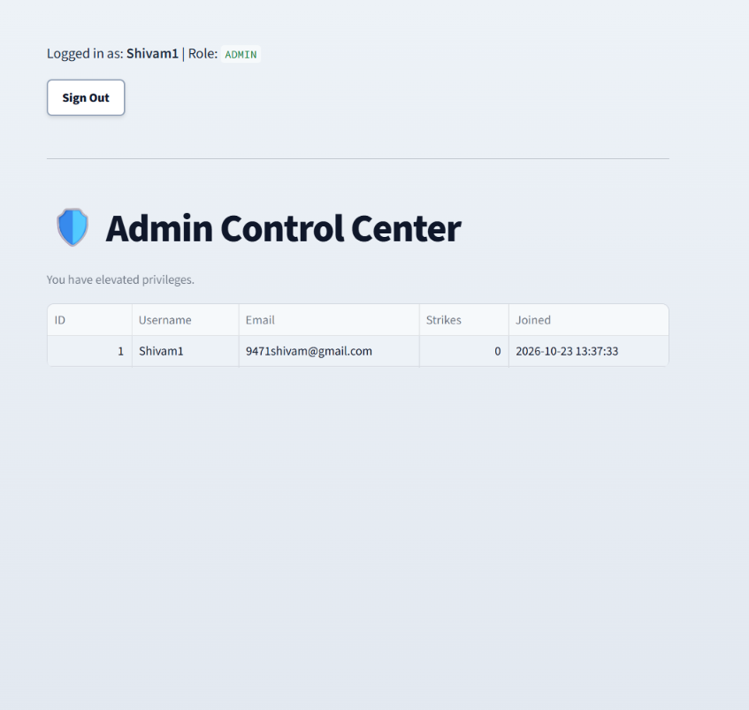

# FreightQuote AI - Milestone 1: User Authentication Module

## Overview
This milestone establishes the foundational security and user management layer for the FreightQuote AI platform. It features a complete, secure, and modularized authentication system built with Streamlit, handling user registration, session management via JSON Web Tokens (JWT), and a dual-route password recovery system.

## Features Built
- **Secure Login & Signup:** Enforces unique usernames, strong password policies (8+ chars, uppercase, lowercase, numbers, symbols), and strict email formatting.
- **JWT Session Management:** Issues session tokens upon successful login to authorize access to protected dashboard routes.
- **Forgot Password & Account Lockout:**
  - **Route 1:** Security Question verification established during signup (rejects blank/space-only answers).
  - **Route 2:** OTP (One-Time Password) verification sent securely via a configured Gmail SMTP server.
  - **Lockout Protocol:** Exceeding 3 consecutive failures suspends account recovery for 3 hours.
- **Role-Based Dashboards:**
  - **User Dashboard:** Protected route welcoming the authenticated user.
  - **Admin Dashboard:** Implicit role-based access. Users logging in with the designated admin email (`9471shivam@gmail.com`) are automatically granted an admin JWT role to view the registered user directory.
- **Premium Maritime UI:** Fully customized "Nautical Slate" theme with animated SVG logistics graphics and strict CSS overriding Streamlit defaults.
- **Environment Security:** Complete separation of credentials utilizing Google Colab Secrets (`NGROK_AUTHTOKEN`, `JWT_SECRET`, `EMAIL_ADDRESS`, `EMAIL_PASSWORD`).

## Technology Stack
- **Frontend / Framework:** Streamlit (Python), `streamlit-lottie`
- **Authentication:** PyJWT (JSON Web Tokens), `bcrypt`
- **Database:** SQLite3
- **Email Delivery:** SMTP (`smtplib`) via Gmail App Passwords
- **Deployment / Tunneling:** `pyngrok`

## How to Run the Notebook
1. Open the `.ipynb` file in Google Colab.
2. Ensure the following Colab Secrets are configured and toggled to grant notebook access:
  - `JWT_SECRET`: A random string for signing tokens.
  - `NGROK_AUTHTOKEN`: Your personal ngrok auth token.
  - `EMAIL_ADDRESS`: The Gmail address used to send OTPs.
  - `EMAIL_PASSWORD`: The 16-character Gmail App Password.
3. Run all cells sequentially (`Runtime` -> `Run all`).
4. Click the public `ngrok` URL generated at the bottom of the notebook to access the live application.

## Screenshots

**1. Login Page**

**2. Signup Page Validation**

**3. Forgot Password (Email OTP)**

**4. OTP Email Received**

**5. Forgot Password (Security Question)**

**6. Admin Dashboard**

