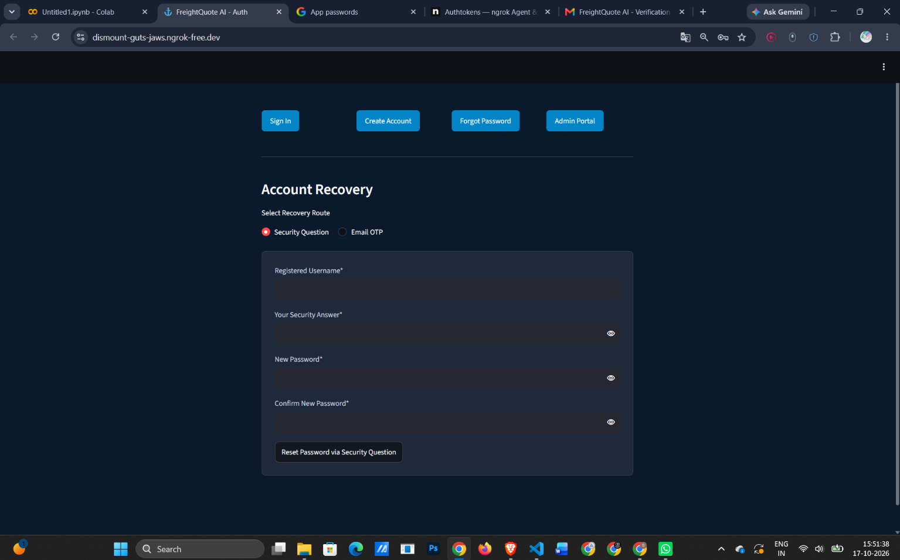
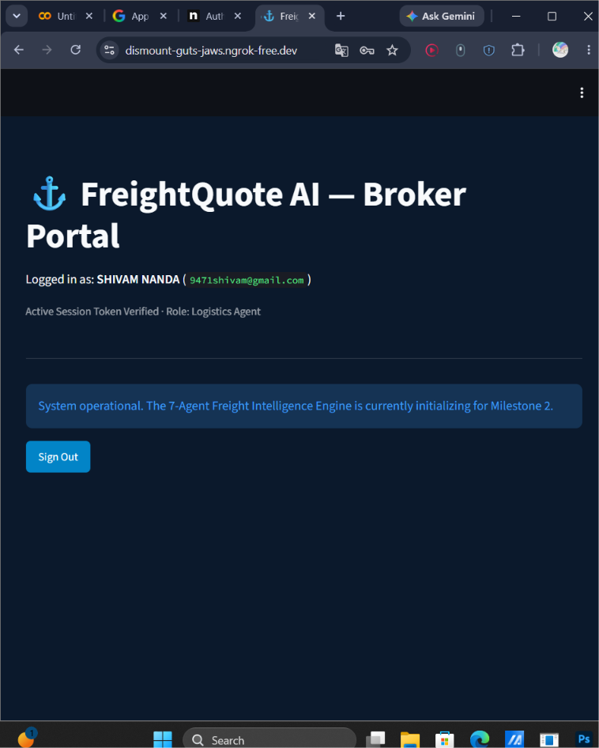

# FreightQuote AI - Milestone 1: User Authentication Module

## Overview
This milestone establishes the foundational security and user management layer for the FreightQuote AI platform. It features a complete, secure authentication system built with Streamlit, handling user registration, session management via JSON Web Tokens (JWT), and a dual-route password recovery system. 

## Features Built
- **Secure Login & Signup:** Enforces unique usernames, strong password policies, and strict email formatting.
- **JWT Session Management:** Issues session tokens upon successful login to authorize access to protected dashboard routes.
- **Forgot Password (Dual-Route):** 
  - **Route 1:** Security Question verification established during signup.
  - **Route 2:** OTP (One-Time Password) verification sent securely via a configured Gmail SMTP server.
- **Role-Based Dashboards:** 
  - **User Dashboard:** Protected route welcoming the authenticated user.
  - **Admin Dashboard:** Hardcoded administrative access displaying a directory of registered users (passwords remain hidden).
- **Environment Security:** Complete separation of credentials utilizing Google Colab Secrets (NGROK, JWT signatures, and Gmail App Passwords).

## Technology Stack
- **Frontend / Framework:** Streamlit (Python)
- **Authentication:** PyJWT (JSON Web Tokens)
- **Database:** SQLite3
- **Email Delivery:** SMTP (smtplib) via Gmail App Passwords
- **Deployment / Tunneling:** pyngrok

## How to Run the Notebook
1. Open the `.ipynb` file in Google Colab.
2. Ensure the following Colab Secrets are configured and toggled to grant notebook access:
   - `JWT_SECRET`: A random string for signing tokens.
   - `NGROK_AUTHTOKEN`: Your personal ngrok auth token.
   - `EMAIL_ADDRESS`: The Gmail address used to send OTPs.
   - `EMAIL_PASSWORD`: The 16-character Gmail App Password.
3. Run all cells sequentially (`Runtime` -> `Run all`).
4. Click the public `ngrok.io` URL generated at the bottom of the notebook to access the live application.

## Screenshots## Screenshots

**1. Login Page**

**2. Signup Page Validation**

**3. Forgot Password (Security Question)**

**4. OTP Email Received**

**5. User Dashboard**

**6. Admin Dashboard**

